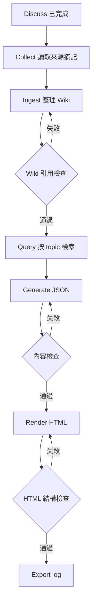

# MLB Advanced Analytics — LLM Wiki 教學簡報

## 專案簡介
從零理解 MLB 進階數據，繁體中文、白底深藍風格、15頁互動簡報。先討論知識範圍、來源及教學大綱，再由 AI 閱讀九份網路來源，整理成中文摘記、主題 Wiki 與教學內容。raw/ 是來源摘記，不是原始網頁全文。2025 例行賽案例固定年份，不使用即時數據。

## 開啟方式
解壓縮後開啟 index.html 即可，不需 API 或伺服器。使用左右鍵、目錄或按鈕。也可用 `python -m http.server 8000` 後瀏覽 http://localhost:8000 。GitHub Pages：將專案內容上傳 repository 根目錄，Settings → Pages → Deploy from a branch → main / root → Save。尚未代為部署。

## 執行方式
Python 3.10+。離線重建：`python workflow.py`（標準函式庫即可）。

LangGraph 模式：`python -m pip install -r requirements.txt`，然後 `python workflow.py --graph`（不用 API）。
API 模式：Windows PowerShell 設定 `$env:OPENAI_API_KEY="你的金鑰"`；macOS/Linux 用 `export OPENAI_API_KEY="你的金鑰"`。執行 `python workflow.py --api`。可設定 OPENAI_MODEL（預設 gpt-4.1-mini）。會產生 API 費用。API 模式將 Wiki 合成結果存於 graph state 並用於生成；檔案版本見 wiki/ 的已審閱基準。API 生成後需人工確認資料與測試。

## Graph

每個條件迴圈最多三次嘗試，失敗則停止。Query 使用明確 topic 路由，而非向量搜尋；Generate 讀取匹配 Wiki。API 模式另以 LLM 語意檢查簡報和 Wiki 一致性；引用檢查本身不能保證事實正確。離線模式直接解析已審閱 Wiki，依序執行同名節點，不自動重試。這是可重現的基準，不等同 API 實驗。

## 檔案
raw/ 九份資料摘記；wiki/ 知識頁與索引；data/ 來源登錄、大綱與生成 JSON；logs/ 測試及執行紀錄；tests/ 測試；AGENTS.md 規則；REFLECTION.md 實際反思。

## 測試
`python -m unittest discover -s tests -p "test_*.py" -v`；瀏覽器測試 `python tests/browser_test.py`（需 Playwright 與 Chromium，若無系統 Chromium 可先 `python -m playwright install chromium`）。本環境因網路限制無法安裝 LangGraph，未執行 LangGraph 或 API，請勿將其描述為已驗證。參閱 logs/。
